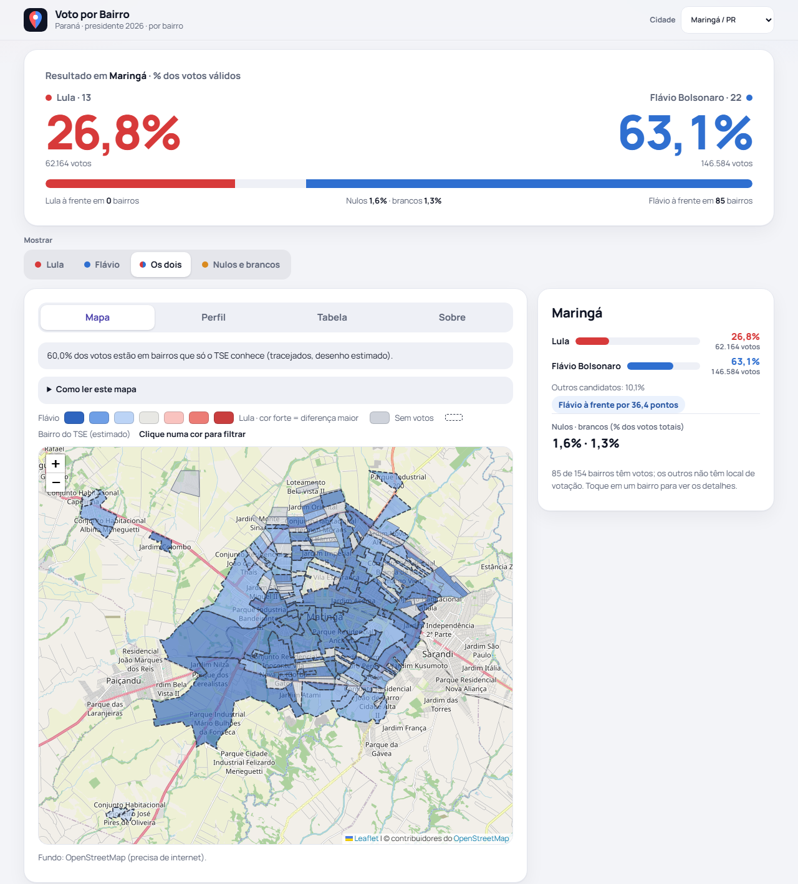
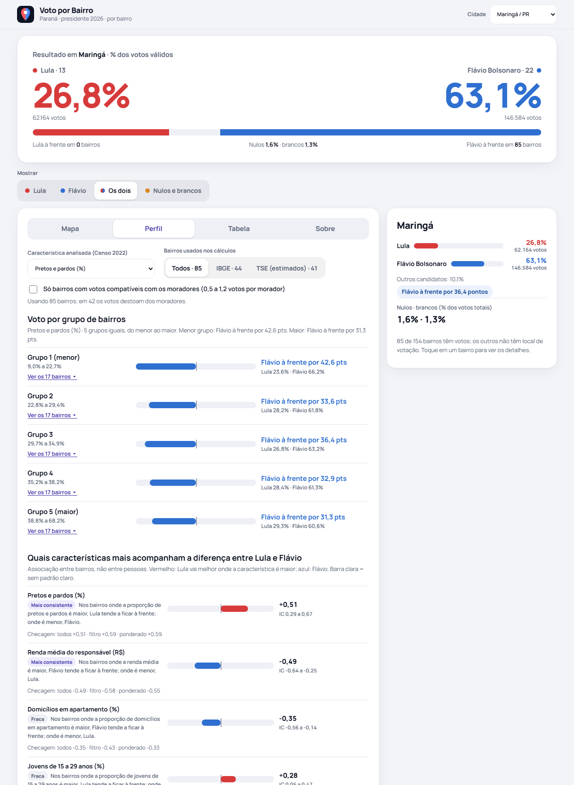
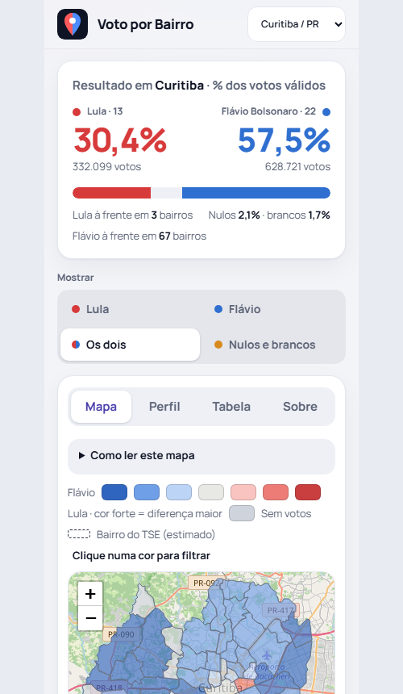
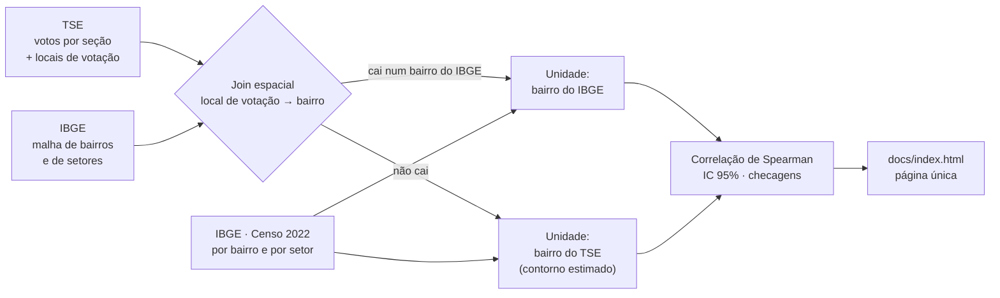

<div align="center">

# 🗳️ Voto por Bairro · Paraná 2026

**Como Lula (13) e Flávio Bolsonaro (22) foram votados, bairro a bairro, no 1º turno presidencial de 2026 no Paraná, cruzado com o Censo 2022.**


**[▶ Abrir a página](https://lorodrig.github.io/Voto_por_Bairro/)** · Maringá · Curitiba · Londrina



</div>

---

## O que é

Uma página única (um arquivo HTML, sem servidor) que responde a perguntas como:

- **Onde** cada candidato foi melhor dentro da cidade? O mapa pinta cada bairro de vermelho (Lula) ou azul (Flávio), mais forte quanto maior a diferença.
- **Que características** do bairro acompanham o resultado: renda, cor ou raça, idade, moradia (apartamento), estrutura familiar, água e esgoto?
- **Quanto confiar** nisso? Cada resultado vem com intervalo de 95%, quatro checagens de robustez e o aviso do que a análise **não** mostra.

É uma **leitura exploratória** de padrões territoriais. Não mede causa nem o comportamento de pessoas.

## O que a página tem

| | |
|---|---|
| 🗺️ **Mapa por bairro** | Quatro visões: Lula, Flávio, **Os dois** (vermelho ↔ azul pela diferença) e **Nulos e brancos**. Clique numa cor da legenda para ver só os bairros daquela faixa. |
| 📊 **Perfil dos bairros** | Bairros em 5 grupos (do menor ao maior em uma característica) com a lista de cada grupo, e um **ranking** de quais características mais acompanham a diferença entre os dois. |
| 🧮 **Tabela** | Ordenável, com busca e **exportação em CSV**. |
| 📖 **Sobre** | Memória de cálculo completa e limites, na própria página. |
| 📱 **Celular** | Layout adaptável; o detalhe do bairro abre como gaveta na parte de baixo. |
| 🔗 **Links compartilháveis** | Cidade, visão, aba e bairro ficam no endereço. |

<div align="center">

&nbsp;&nbsp;

</div>

## Como funciona



**1. Votos por bairro.** Cada local de votação (com latitude e longitude do TSE) é colocado dentro do bairro do IBGE em que cai, por ponto em polígono. 100% dos votos de seções cadastradas entram em alguma unidade.

**2. Bairros que o IBGE não desenha.** O IBGE só delimita parte dos bairros em algumas cidades. Onde não há polígono, vale o **bairro cadastrado pelo TSE** para aquela urna. Como o TSE não publica limites, o contorno é **estimado**: os setores censitários sem bairro são entregues ao bairro do TSE com o local de votação mais próximo do centro do setor. O Censo desses bairros soma os mesmos setores.

| Cidade | Votos em bairros do IBGE | Votos em bairros do TSE (estimados) |
|---|---:|---:|
| Curitiba | 100% | 0% |
| Londrina | 96,3% | 3,7% |
| Maringá | 40,0% | 60,0% |

**3. Características do Censo 2022 por bairro (9):** renda média do responsável, pretos e pardos, pessoas com 60+, jovens de 15 a 29, domicílios em apartamento, mulheres responsáveis, densidade, água em rede e esgoto em rede.

**4. Correlação.** Spearman entre cada característica e a diferença Lula − Flávio, cada bairro pesando igual, com **intervalo de 95%** por 300 reamostragens de bairros. Em cada linha há quatro **checagens**: todos os bairros, só os de votos compatíveis com os moradores, ponderada por votos válidos e ponderada pela população do Censo 2022.

## Cuidados de leitura

- **Associação entre áreas, não comportamento individual** (falácia ecológica). Bairros mais ricos darem vantagem a um candidato não significa que pessoas ricas votaram nele.
- **O voto é contado onde fica a urna, não onde a pessoa mora.** A coluna *Votos ÷ moradores* mostra o quanto isso distorce; há um filtro exploratório (0,5 a 1,2) e a checagem sem ele.
- **Poucas dezenas de bairros** por cidade e bairros vizinhos que se parecem (dependência espacial): o intervalo é apoio exploratório, não teste definitivo.
- **Os bairros do TSE são a parte mais frágil:** contorno e Censo estimados.
- **Cor ou raça** é autodeclarada no Censo; a relação é entre áreas.
- **Renda** é a média do responsável com renda, não renda familiar nem per capita.

## Qualidade e verificação

- **Testes automatizados** (`pytest`) usados no desenvolvimento cobrem o join espacial, a atribuição de setores, o contorno dos bairros, a agregação do Censo e as correlações; eles não fazem parte deste repositório.
- **`scripts/05_validar.py`:** reconcilia os votos por seção, município e unidade (todos os votos de seções cadastradas entram em alguma unidade).
- **Conferência independente:** cada métrica do Censo e as correlações foram recalculadas por um segundo programa, direto dos arquivos brutos, e coincidem até a 4ª casa decimal (inclusive nos bairros do TSE).
- **Interface:** testada em Chrome headless em milhares de combinações de controles, sem erro de JavaScript.

## Estrutura

```
docs/
  index.html            a página (publicada pelo GitHub Pages)
  img/                  capturas usadas neste README
scripts/
  01_tse.py             votos por seção, bairro e município
  02_integrar.py        Censo por município e por bairro, Inep, Caged
  02b_sidra_parana.py   escolaridade e desocupação por município (SIDRA)
  03_analisar.py        análise municipal (atlas nacional)
  04_relatorio.py       atlas nacional por município (opcional)
  05_validar.py         reconciliações e verificações finais
  06_bairros_espacial.py  join espacial, unidades de bairro, contornos
  07_analise_parana.py  correlações por bairro com intervalo
  08_relatorio_bairros.py  gera a página única
  09_setores.py         Censo por setor e lista das características
  vendor/               Leaflet, fonte Manrope e ícones (embutidos na página)
data/catalogs/          manifesto das fontes (URL, data e SHA-256) e listagens de arquivos
```

`data/raw/` (1,8 GB) e `outputs/` **não estão no repositório**; veja *Dados*.

## Reproduzir

Requisitos: Python 3.12 com `pandas`, `numpy` e `pyarrow`. O `geopandas` **não é necessário**: o join espacial usa só `sqlite3` e `numpy` (lê o GeoPackage direto).

```bash
# (bash) 1) baixe os dados brutos para data/raw/ (veja "Dados")
python scripts/01_tse.py                      # votos por seção
python -c "import sys; sys.path.insert(0,'scripts'); import importlib; importlib.import_module('02_integrar').ibge('bairros')"
for c in 4115200 4106902 4113700; do       # Maringá, Curitiba, Londrina
  python scripts/06_bairros_espacial.py --uf PR --municipio $c
done
python scripts/07_analise_parana.py 4115200 4106902 4113700
python scripts/08_relatorio_bairros.py        # grava outputs/ e docs/index.html
python scripts/05_validar.py
```

Outra cidade do Paraná: rode o `06_bairros_espacial.py` com o código IBGE dela e depois o `07` e o `08`. O nome do projeto está em `NOME_PROJETO`, em `scripts/08_relatorio_bairros.py`.

## Dados

| Fonte | Uso |
|---|---|
| **TSE** | Votação por seção (1º turno, presidente, 2026), locais de votação com coordenadas, correspondência de códigos TSE ↔ IBGE |
| **IBGE** | Censo 2022 agregado por bairro e por setor (básico, demografia, domicílios, parentesco, cor ou raça, renda); malhas de bairros e de setores do Paraná |
| **Inep, MTE/Caged** | Atlas municipal nacional (fora do relatório por bairro) |
| **OpenStreetMap** | Fundo do mapa, carregado pela internet; sem conexão os bairros continuam visíveis |

Os URLs e os SHA-256 dos arquivos baixados do IBGE estão em `data/catalogs/manifesto_fontes.csv`. As páginas de catálogo do TSE, IBGE, Inep e MTE, de onde saíram os arquivos, foram consultadas durante o projeto e não são republicadas aqui.

## Tecnologia

Python (`pandas`, `numpy`, `pyarrow`, `sqlite3`) para o processamento; HTML, CSS e JavaScript puros na página, com [Leaflet](https://leafletjs.com) 1.9.4 para o mapa e a fonte [Manrope](https://github.com/sharanda/manrope) (SIL OFL) embutidas. Sem framework, sem servidor, sem cookies e sem coleta de dados.
